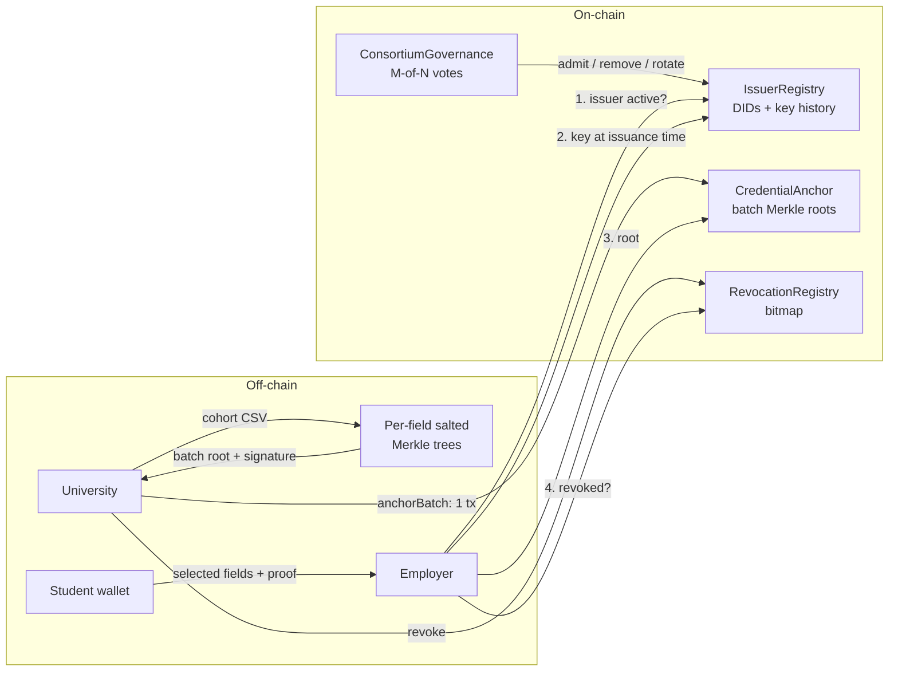

# VeriCred

**A scalable, privacy-preserving blockchain architecture for academic credential verification.**

VeriCred lets a university anchor an entire graduating class on a blockchain in **one transaction**, lets each student prove only the facts an employer needs (for example a degree, without the GPA), and lets an employer verify the result in milliseconds **without contacting the university**.

[](https://soliditylang.org/)
[](https://hardhat.org/)
[](https://react.dev/)
[](https://nodejs.org/)
[](#testing)

---

## Table of contents

- [The problem](#the-problem)
- [Key features](#key-features)
- [How it works](#how-it-works)
- [Measured results](#measured-results)
- [Tech stack](#tech-stack)
- [Quick start](#quick-start)
- [Using the console](#using-the-console)
- [Smart contracts](#smart-contracts)
- [REST API](#rest-api)
- [Testing](#testing)
- [Reproducing the experiments](#reproducing-the-experiments)
- [Repository layout](#repository-layout)
- [Security model and limitations](#security-model-and-limitations)
- [Team](#team)

---

## The problem

Checking an academic credential today usually means emailing the university and waiting. Existing blockchain approaches improve on that but have three recurring weaknesses:

1. **Cost.** Writing one transaction per credential makes issuing a large cohort expensive. Cost grows linearly with the number of students.
2. **Privacy.** Presenting a credential reveals the whole record, including grades the employer never needed.
3. **Trust.** A single issuer controls its own registry, so there is no consortium-level control over who may issue or how a compromised key is handled.

## Key features

| Feature | What it does |
| --- | --- |
| **Merkle batch anchoring** | A whole cohort is hashed into a Merkle tree and only the 32-byte root is written on-chain. Cost per cohort is flat (about 148K gas), regardless of cohort size. |
| **Selective disclosure** | Every field is a separate salted leaf. A student reveals chosen fields and the rest stay hidden behind opaque hashes. |
| **Four-step verification** | Issuer membership, signature at issuance-time key, Merkle proof against the on-chain root, and revocation status. Every step is checked against the chain. |
| **Bitmap revocation** | Revocation status for 256 credentials shares one storage word, which makes revoking cheaper and a status check a single read. |
| **Key rotation with history** | An institution can rotate its signing key through a governance vote. Old credentials still verify because the signature is checked against the key that was valid when it was issued. |
| **Consortium governance** | Adding or removing an issuer, or rotating a key, needs an M-of-N vote. No single administrator. |
| **Presentation console** | A React console for all four roles, with live chain statistics, a verification pipeline animation, a tamper demonstration and step-by-step guides on every page. |

## How it works



1. **Issue.** The university uploads a cohort. For each student, every field is hashed with its own random salt into a student root. Student roots are combined into a batch root, which the university signs and anchors in a single transaction.
2. **Hold.** The student receives their fields, salts and Merkle proof. To share, they choose which fields to disclose and generate a presentation (JSON and QR code).
3. **Verify.** The employer submits the presentation. The verifier checks the issuer is an active consortium member, the signature matches the key that was valid at issuance time, the disclosed fields rebuild the on-chain root, and the credential is not revoked. If any disclosed value was altered, the Merkle proof fails.

A credential id is `(batchId << 32) | leafIndex`, so the revocation bitmap can be addressed directly from the id.

## Measured results

All numbers come from real runs against the deployed contracts. Raw data is in [`experiments/results/`](experiments/results).

| Metric | Result |
| --- | --- |
| Gas to anchor a cohort (any size from 10 to 5,000) | about **148,000** gas, flat |
| Gas to issue one credential per transaction | about **126,000** gas each |
| Cohort of 5,000: batch vs. one-per-credential | **148K** vs. **631M** gas, roughly 4,000x cheaper |
| Revocation, bitmap vs. one mapping entry per credential | about **32%** less gas at 10 and 100 revocations |
| End-to-end verification (server side) | **under 30 ms**, up to a 5,000-student batch |
| Presentation size, 1 to 7 of 8 fields disclosed | 2.2 to 2.4 KB |
| Backend throughput (concurrent `/verify` requests) | 24 to 34 requests per second, limited by sequential RPC reads |
| Governance: onboard one issuer under 1-of-1 to 5-of-9 | 1 to 5 transactions |

Revocation savings are smaller than the "256 per word" figure suggests, because the first revocation in each word still pays the zero-to-nonzero storage cost. See [`experiments/README.md`](experiments/README.md) for the full explanation of every table.

## Tech stack

| Layer | Technology |
| --- | --- |
| Smart contracts | Solidity 0.8.24, OpenZeppelin, Hardhat 2 |
| Off-chain library | Node.js, ethers v6, custom Merkle tree with domain-separated hashing |
| Backend | Express 5, multer, csv-parse, qrcode |
| Frontend | React 19, Vite 8 (no UI framework; custom design system) |
| Experiments | Hardhat scripts, Python (pandas, matplotlib) |

## Quick start

**Prerequisites:** Node.js 20 or later and npm.

```bash
git clone https://github.com/akshat-singh05/vericred.git
cd vericred/implementation
npm install
npm install --prefix frontend
```

Start the stack in four terminals, from `implementation/`:

```bash
# 1. Local blockchain (leave running)
npm run node
```

```bash
# 2. Deploy contracts and seed the demo consortium (2-of-3 governance, two universities)
npm run deploy
```

```bash
# 3. Backend API on http://127.0.0.1:4000
npm run backend
```

```bash
# 4. Console on http://127.0.0.1:5173
cd frontend && npm run dev
```

The local chain starts empty each time it is launched, so run `npm run deploy` again after restarting it.

## Using the console

Open <http://127.0.0.1:5173>. Each page has a collapsible guide with the exact steps, and the Overview has a five-step quick start.

| Page | Role | What you do |
| --- | --- | --- |
| **Overview** | Everyone | Live chain statistics, measured gas chart, contract addresses and an on-chain activity feed. |
| **Issuer** | University | Pick the university, load the sample cohort (or your own CSV), anchor it in one transaction, and optionally revoke a credential. |
| **Holder** | Student | Look up a student ID (for example `S101`), switch fields on or off, and generate a QR code and presentation. |
| **Verifier** | Employer | Verify a presentation, watch the four checks run, and use **Simulate tampering** to see a forged claim rejected. |
| **Governance** | Consortium | Propose adding, removing or re-keying an institution and vote until it reaches the 2-of-3 threshold. |
| **How it works** | Everyone | The architecture and design decisions in one page. |

Suggested demo order: **Issuer** (anchor the sample cohort), **Holder** (hide the GPA, send to the verifier), **Verifier** (verify, then simulate tampering), **Governance** (propose a new university and vote it in).

A cohort CSV needs a `studentId` column plus one column per credential field:

```csv
studentId,name,degree,major,graduationYear,gpa
S101,Asha Rao,B.Tech,CSE,2025,9.1
S102,Ben Iyer,B.Tech,ECE,2025,8.4
S103,Chitra Nair,M.Tech,CSE,2025,9.6
```

## Smart contracts

| Contract | Responsibility |
| --- | --- |
| [`ConsortiumGovernance`](implementation/contracts/ConsortiumGovernance.sol) | M-of-N proposals and votes to add or remove an institution or rotate its signing key. Executes automatically at the threshold. |
| [`IssuerRegistry`](implementation/contracts/IssuerRegistry.sol) | Institution DIDs, active status and a signing-key history queried by timestamp (`signingKeyAt`). Only governance may change it. |
| [`CredentialAnchor`](implementation/contracts/CredentialAnchor.sol) | `anchorBatch` stores a batch Merkle root. `issueSingle` is a one-credential baseline used only for cost comparison. |
| [`RevocationRegistry`](implementation/contracts/RevocationRegistry.sol) | Bitmap revocation, 256 credentials per storage word. Only the issuing institution can revoke. |
| [`NaiveRevocationRegistry`](implementation/contracts/NaiveRevocationRegistry.sol) | One-mapping-entry-per-credential baseline for the revocation benchmark. |

Each institution has two decoupled keys: an **on-chain account** that sends transactions, and an **off-chain signing key** that signs batch roots and can be rotated independently by governance.

## REST API

The backend listens on `http://127.0.0.1:4000`.

| Method and path | Purpose |
| --- | --- |
| `GET /health` | Deployment info and contract addresses |
| `GET /stats` | Chain statistics, labels and recent on-chain activity |
| `GET /issuer/institutions` | Registered institutions and their status |
| `POST /issuer/batches` | Build and anchor a cohort batch |
| `GET /issuer/batches`, `GET /issuer/batches/:id` | List batches or read one with its students |
| `POST /issuer/cohort/parse` | Parse an uploaded cohort CSV |
| `POST /issuer/revoke` | Revoke a credential |
| `GET /issuer/revocation-status/:credentialId` | Check whether a credential is revoked |
| `GET /holder/:studentId/credentials` | Credentials held by a student |
| `POST /holder/disclosures` | Build a selective-disclosure presentation with a QR code |
| `POST /verifier/verify` | Run the four verification checks on a presentation |
| `GET /governance/members`, `GET /governance/proposals` | Consortium state |
| `POST /governance/proposals`, `POST /governance/proposals/:id/vote` | Propose and vote |

## Testing

```bash
cd implementation
npm test
```

52 tests cover every contract function plus negative cases: unauthorized callers, double votes, non-member votes, removed issuers, tampered fields, tampered salts, forged Merkle proofs, wrong-key signatures and revoked credentials. A gas report is printed per function.

## Reproducing the experiments

Six benchmark scripts live in [`implementation/scripts/experiments/`](implementation/scripts/experiments) and write CSV files to [`experiments/results/`](experiments/results). Plot scripts in [`experiments/plots/`](experiments/plots) turn them into vector figures.

```bash
cd implementation
npx hardhat run scripts/experiments/01_issuance_cost.js
npx hardhat run scripts/experiments/02_revocation_cost.js
npx hardhat run scripts/experiments/03_verification_latency.js
npx hardhat run scripts/experiments/04_selective_disclosure_overhead.js
npx hardhat run scripts/experiments/06_governance_cost.js
# 05_throughput.js needs the full stack running (see Quick start)
node scripts/experiments/05_throughput.js
```

See [`experiments/README.md`](experiments/README.md) for how to read each result file and generate the plots.

## Repository layout

```
implementation/
  contracts/      Solidity contracts, interfaces and the credential-id library
  offchain/       Merkle tree, issuance, selective disclosure and verifier library
  backend/        Express REST API (issuer, holder, verifier, governance, stats)
  frontend/       React + Vite console
  scripts/        Deployment script and experiment runners
  test/           Hardhat test suite (unit and end-to-end)
experiments/
  results/        Raw benchmark CSV files
  plots/          Plot scripts
```

More detail is in [`implementation/README.md`](implementation/README.md).

## Security model and limitations

This is a research prototype. Read these before extending it.

- **Single-node devnet.** The local Hardhat network models the authorization layer of a permissioned consortium (who may call what), not multi-validator consensus such as QBFT.
- **Salted-hash disclosure, not zero-knowledge.** Two presentations of the same credential can be linked through the shared student root.
- **Demo backend holds secrets centrally.** For demonstration, the backend stores institutions' off-chain signing keys and each student's field salts. A real deployment keeps signing keys in an HSM or the institution's own service, and gives salts only to the student's device. The files involved (`backend/deployment.json`, `backend/data/`) are gitignored and regenerated on every deploy.
- **Test accounts only.** The chain uses Hardhat's publicly known development accounts. Never reuse them on a real network.
- **Throughput is RPC-bound.** The verifier issues several sequential chain reads per request with no caching.

## Team

Developed at **Vellore Institute of Technology (VIT), Vellore** by **Akshat Singh** and **Nabhya Maheshwari**, under the guidance of **Poornima N**, Assistant Professor Sr. Grade 1.
